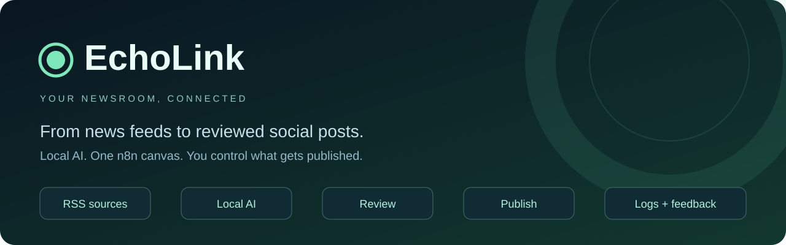

  

<strong>One workspace for your content, brands and publishing.</strong> 
EchoLink brings newsroom stories, product campaigns and social publishing into a managed content platform for growing businesses and media teams.

  <a href="https://echolinkbd.vercel.app/">Open EchoLink</a> ·
  <a href="https://echolinkbd.vercel.app/demo/">Explore the product demo</a> ·
  <a href="mailto:support@fabrything.com?subject=EchoLink%20product%20walkthrough">Request a walkthrough</a>

## Built around your publishing day

Manage several brands without mixing their content, settings or publishing calendars. Give each Page its own voice, creative direction, sources and approval rules. Follow a story or campaign from its first draft to a confirmed delivery in one place.

| Your team | What EchoLink brings together |
| --- | --- |
| Newsrooms and publishers | Source collection, Bengali news writing, editorial checks, website delivery and social distribution |
| Ecommerce brands | Product catalogues, branded designs, channel captions and recurring campaigns |
| Agencies and creators | Separate Page workspaces, reusable prompts, content libraries and publishing calendars |
| Platform operators | Service health, queue visibility, API traffic, model usage and capacity monitoring |

## A content desk that stays current

**Find the work that matters.** Move between drafts, review, scheduled content and published posts. Search the loaded library, switch between list and preview grid views, and open a focused details window to inspect the complete creative, captions and delivery receipts. Published content is ordered by confirmed publication time.

**Keep your brand consistent.** Maintain Page-specific prompts, logos, fonts and creative preferences. Focused settings sections organize brand, writing, channels, publishing and connections. Prepare news, commerce and original content through a shared workflow while keeping each Page's identity.

**Plan with confidence.** Use the calendar to reserve publishing slots and follow the next scheduled post. Automation follows the Page's approval, spacing and posting rules. Delivery receipts distinguish confirmed publication from a request that still needs attention.

## Newsroom and commerce workflows

EchoLink supports source-grounded Bengali news articles and social captions, with checks for factual support, originality, language and sensitive reporting. Configured newsroom workflows can publish the website article before preparing its social creative and scheduling distribution. Editors retain control over corrections and approval rules.

Commerce workflows turn catalogue products into branded content and keep a durable publishing history as the active catalogue advances. Captions omit product prices and direct customers to the website for the updated price. Brand-led artwork supports coordinated background variations, headline treatments, pointer accents and licensed custom fonts.

For connected stores, focused journal guides bring together reader problems, product comparisons, useful accessories and attributable sources. Structured product cards, clear affiliate disclosures and responsive article layouts support a consistent reading and shopping experience. Website-only profiles can research, write, review and schedule guides through a signed publishing connection, with saved drafts and delivery receipts. Journal publishing is opt-in and depends on the configured website and editorial workflow.

Facebook and Instagram delivery depend on the connected account, permissions and supported content type. Personal-profile workflows use a manual sharing handoff. Editorial checks support a team's judgment; they do not independently verify every fact or guarantee a platform's monetization eligibility.

## Video Studio · planning preview

Plan videos for YouTube, Facebook, Instagram and TikTok with a dedicated production interface:

- Research references, audience, niche, custom prompts and creative briefs.
- Scripts, storyboards, scene prompts, voice direction and caption planning.
- A timeline and review checklist with channel-specific export profiles.

Video Studio currently saves planning drafts in the browser for each workspace and Page. Video generation, tool connectors, rendering, export and platform uploads are planned capabilities, not connected production services. The public demo uses illustrative content.

## Visibility for the people running the service

The Owner console brings connection health, pending work, API requests, database activity and native inference token counts into a single Operations Monitor. Automatic refresh and explicit stale states help operators see when a dependency needs attention.

Usage views show measured activity and its collection window. Capacity indicators distinguish configured resources from capabilities that are not enabled, including load balancing and automatic database failover. This keeps service decisions grounded in the deployment's actual behavior.

## A managed relationship

EchoLink is offered as a SaaS product with workspace access, onboarding and integrations arranged with our team. This repository supports the product's development. Workspace access and managed deployments are arranged with the service owner. Deployment procedures, credentials and operating configuration are not part of this product overview.

For a walkthrough, onboarding or a conversation about your Pages, contact [support@fabrything.com](mailto:support@fabrything.com) or [chat with the EchoLink team](https://wa.me/8801353529899).

EchoLink by Fabrything · Content operations for newsrooms, brands and creators.

