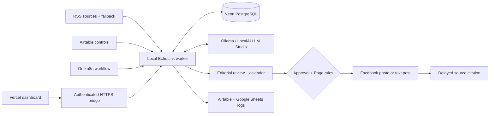

<p align="center">
  
</p>

<p align="center">
  <a href="https://github.com/proffesergio/echolink/actions/workflows/deploy-dashboard.yml"></a>
  <a href="https://github.com/proffesergio/echolink/stargazers"></a>
  <a href="https://github.com/proffesergio/echolink/issues"></a>
  
  
</p>

<p align="center"><strong>A local-AI newsroom with an editorial control center.</strong><br>
Collect Bangla news, prepare source-supported drafts, review photos, schedule posts and track delivery—on one connected n8n canvas.</p>

<p align="center">
  <a href="#start-building">Quick start</a> ·
  <a href="docs/PUBLISHING_PLATFORM.md">Publishing guide</a> ·
  <a href="docs/WINDOWS_GUIDE.md">Windows setup</a> ·
  <a href="CONTRIBUTING.md">Contribute</a> ·
  <a href="https://github.com/proffesergio/echolink/issues">Report a bug</a>
</p>

> **Help build a better local newsroom.** If EchoLink is useful, [give it a star](https://github.com/proffesergio/echolink/stargazers), share a reproducible issue, improve a guide or contribute an adapter. Real-world reports help us make the project more reliable.

> **v2 is available for public testing:** [Open EchoLink](https://echolinkbd.vercel.app/) for private creator workspaces, multiple Pages, niche-specific routines, product creatives and owner controls. Start with [Page workspaces and the calendar](docs/PAGE_WORKSPACES.md), then follow the [live testing guide](docs/LIVE_V2_TESTING.md) or [platform setup guide](platform/README.md). The protected Windows worker runs local inference and publication jobs.

> **Worker setup:** `n8n start` starts n8n, not the creator worker. Run `npm run platform:start` from the EchoLink folder to start the supervised worker, protected tunnel and Ollama. See [Creative operations](docs/CREATIVE_OPERATIONS.md) for the generation studio, premium product/news layouts, per-Page Meta apps, personal-profile handoffs and measured insights.

## November Page operations

Product-aware creatives use only verified specifications. Configure five-minute website-link comments per Page, inspect Facebook/Instagram measurements, or draft a new Page profile/cover with a custom prompt. **Page branding** previews designs before an explicit Facebook update. NobleSeek now uses [nobleseek.fabrything.com](https://nobleseek.fabrything.com). See [Creative operations](docs/CREATIVE_OPERATIONS.md) for behavior, permissions and current limits.

Airtable is optional: Neon stores the primary records and the dashboard manages them. Google Sheets can serve as an additional reporting copy.

**Publishing recovery update:** website-enabled news is verified on the live domain before Facebook submission. Separate destination receipts, a Needs attention queue, measured task timings and configurable colored news headlines are available in the creator dashboard. See the [delivery and design guide](docs/CREATIVE_OPERATIONS.md#website-first-delivery-and-visible-recovery).

## Creator operations update

- **Catalogue to creative:** category/search/stock filters, category rotation and priority post preparation.
- **Brand-led layouts:** price-free product posters, verified fabric/color annotations, website and social footers, and category-labelled news images.
- **Watch the work:** timestamped task console, measured stage progress and the next-post countdown.
- **Facebook + Instagram:** one calendar slot and finished image, independently editable channel captions and styles, plus separate delivery records. Instagram retries never repeat Facebook.
- **Adaptive branding:** transparent light/dark logo choices, shorter product headlines and a centered website badge with corner social handles.
- **Cloud planning:** see the [Oracle Free Tier assessment](docs/ORACLE_HOSTING.md) for current limits and the separate n8n/worker migration requirements.
- **Per-type prompts:** separate caption and image direction for each Page’s news, product, quote and original content.

Follow [Creative operations](docs/CREATIVE_OPERATIONS.md). Planned Text/Image/Reels mixes and YouTube tooling are tracked in the [release roadmap](docs/PLATFORM_ROADMAP.md).

## A newsroom you can control

The [operations dashboard](docs/DASHBOARD.md) brings 13 workspaces into a compact
charcoal/coral console: searchable provider cards, connection settings drawers,
read-only tests, a publishing calendar and measured task progress. Saved settings,
verified checks, failures and planned integrations have separate visible states.

| Collect & understand | Review & publish | Observe & recover |
| --- | --- | --- |
| Catalog of 20 verified Bangla publishers | Review, edit, save Draft, approve, Publish Now | Per-task stage percentages and event logs |
| RSS fallback and article extraction | Monthly calendar with available-slot suggestions | n8n initiation, local-AI and output-saving indicators |
| Per-Page URL/title deduplication | Reviewed photo + caption + relevant hashtags | Airtable and Google Sheets status mirrors |
| Ollama, LocalAI or LM Studio | Timezones, quiet hours, daily caps and spacing | Meta permission checks, cooldowns and visible errors |
| Optional local semantic matching | Delayed source-link comments | Durable attempt journal and ambiguous-write holds |

**Built for Bangla, configurable per Page.** English and bilingual styles are available too. Local models can still invent facts or misattribute statements: keep human approval enabled and compare every publishable draft with its source. Source images need appropriate permission to reuse; EchoLink does not generate or license documentary photos.

## How it fits together

The creator platform supports multiple niches and languages, independent Page
websites, product catalogs, branded creatives, automatic scheduling and measured
insights. Personal profiles use scheduled manual sharing. Future YouTube video
workflows and remaining adapters are tracked in the
[creator platform roadmap](docs/PLATFORM_ROADMAP.md).
The [NobleSeek connector guide](docs/WEBSITE_PUBLISHING.md) covers local database
settings and the owner's automatic-link opt-out.



Neon holds the canonical queue, locks, schedules, approval state and delivery journal. Airtable manages Page/feed settings and mirrors outcomes. The Vercel frontend controls a worker on your own machine through a restricted bridge; it does not host n8n or run local inference.

## Start building

**Prerequisites:** Node.js 22+, a running n8n instance, your own Neon PostgreSQL project and Airtable base. Install Ollama or another supported runner for local inference. Facebook and Google credentials are needed only for their integrations.

```bash
git clone https://github.com/proffesergio/echolink.git
cd echolink
npm ci
npm test
npm run build
```

For a configured worker:

1. Create a private `.env.local` using [.env.example](.env.example). Pull your Neon Postgres variables with `neon env pull --service postgres --file .env.local` before adding your other settings; preserve existing credentials. Use a random `WORKER_API_KEY` of at least 32 characters and start with `DRY_RUN=true`.
2. Test migrations on a disposable Neon branch, then apply them to your chosen runtime branch with `npm run migrate`. Migrations use direct `DATABASE_URL_UNPOOLED`; normal queries use pooled `DATABASE_URL`.
3. Configure Airtable using the [schema/setup guide](docs/airtable.md) and `npm run airtable:setup`.
4. Run `npm start`, then `npm run dashboard`. Configure the Page, local model and feeds in the UI.
5. Import [00-complete-pipeline.json](workflows/00-complete-pipeline.json) into n8n. Attach an HTTP Header Auth credential named `Authorization` with value `Bearer <WORKER_API_KEY>` to the worker HTTP nodes. The initial machine bootstrap helper is documented in the Windows guide.
6. Generate a preview, verify its source and photo, then connect Facebook using the [Page token guide](docs/FACEBOOK_TOKEN.md). **A token that can read the Page may still lack permission to publish.**
7. Enable live mode only when ready. Activate the combined workflow and keep older individual schedules stopped. Use the [publishing guide](docs/PUBLISHING_PLATFORM.md) for the first real post and source-comment acceptance check.

**Windows 11 / WSL / Docker:** Start with the [Windows guide](docs/WINDOWS_GUIDE.md). For npm-hosted n8n, the worker defaults to `http://127.0.0.1:8787`. Containerized n8n needs a reachable worker address; see [deployment notes](docs/CI_CD.md) and `compose.worker.yaml`. Keep worker ports private.

## Publishing that explains its state

- **Publish Now** starts background delivery after Page activation, token permissions, approval and posting rules pass. A confirmed Facebook ID is required before a post appears as Published.
- **Schedule** reserves a future slot inside Page hours, respecting daily capacity and minimum spacing. A scheduled time is the earliest eligible delivery time; downtime and Meta cooldowns can delay it.
- **Photos stay selected.** An image rejection remains visible; it never silently becomes a text-only post.
- **Failures stay actionable.** Missing permissions, expired credentials and rejected media have different diagnostics. No repeated retry of a Page restriction or uncertain write.
- **Progress is measured by completed work.** Tasks show stages/feeds completed, percentage, elapsed time, heartbeat and a bounded event log. AI generation has no reliable time estimate; its percentage stays at that stage until output arrives.
- **Old work cannot spin forever.** Stale heartbeats and task deadlines become Interrupted. Unknown publication outcomes require reconciliation before retrying.

The single workflow checks every minute. Default intervals:

| Job | Cadence | Work |
| --- | --- | --- |
| Sync | 15 min | Airtable Page/feed settings → Neon |
| Source comments | 1 min | Send due citations, respecting quiet hours/cooldowns |
| Ingest | 10 min | Fetch feeds, fallback, extract and deduplicate |
| Approvals | 1 min | Read explicit editorial decisions |
| Process | 1 min | Rank news, generate/review or deliver eligible posts |
| Mirror | 2 min | Update Airtable and configured Google Sheets logs |
| Analytics | 6 hr | Collect supported post engagement metrics |

All exported workflows start inactive. Page limits are configurable and count EchoLink publications; they are not a guarantee against Meta restrictions or a count of posts made directly on Facebook. Automatic generation pauses at three pending reviews. Schedules more than six hours late become held Drafts.

## Run locally, manage from anywhere

The project dashboard is at [echolinkbd.vercel.app/admin](https://echolinkbd.vercel.app/admin). It is a private deployment, not a public sandbox; it requires authentication and its owner's local worker/tunnel. Deploy your own instance using the [CI/CD guide](docs/CI_CD.md).

Keep the PC awake and n8n, the worker, your AI runner and the HTTPS bridge online for scheduled delivery. A frontend deployment alone cannot run the automation while the PC is off.

## What works—and what still needs care

| Available now | Optional / roadmap |
| --- | --- |
| Local runner adapters, Bangla drafts and [quality diagnostics](docs/CAPTION_QUALITY.md) | Reliable broader factual evaluation and stronger local models |
| Editorial controls, photo delivery and calendar rules | Expanded network publishing through Postiz |
| Airtable, Neon and Google Sheets integration | Qdrant/MCP semantic-memory migration |
| Token-scope checks and task progress | Additional scraper/MCP adapters and paid providers |
| Vercel frontend + authenticated local bridge | Always-on worker hosting and richer team permissions |

The optional semantic layer checks prior posts using bounded local embeddings stored as JSON in Postgres, including prepared captions and missing historical vectors. It remains disabled on the current installation: calibration found both false matches and missed duplicates. See the [semantic evaluation and setup](docs/SEMANTIC_DEDUPLICATION.md) before enabling it. Qdrant, Postiz and scraper MCP options are plans, not advertised as connected services. The repository includes optional Neon AI Gateway, Object Storage and Function configuration; enable and verify these separately, considering provider availability and cost. See [integration notes](docs/integrations.md), [production testing](docs/PRODUCTION_TESTING.md) and the [project plan](PROJECT_PLAN.md).

## Test with evidence

```bash
npm test                           # Unit, policy, auth and transport checks
npm run build                      # Syntax, dashboard assets and n8n exports
npm run verify:dashboard           # Authenticated local worker checks
npm run verify:cms                 # Browser controls with intercepted writes
npm run public:check               # Local services, bridge and public reachability
```

With your own authorized Neon CLI/project, `node scripts/validate-migration.mjs` creates a disposable branch, tests migrations, scheduler claims, editorial transitions, delivery state and progress recovery, then removes it. Facebook delivery tests use mocks. Unit or browser tests do not prove a real Page post is publicly visible; complete a reviewed live-post and delayed-comment acceptance check separately.

## Build with us

Contributions can be small and useful:

- **Newsroom users:** report confusing controls, feed failures and factual-quality problems with sanitized examples.
- **Developers:** improve accessible UI, task observability, error handling, concurrency tests and adapter boundaries.
- **Bangla editors:** help evaluate names, numbers, attribution and natural writing across local models.
- **Documenters:** make Windows, Docker, Meta and Google setup easier to reproduce.

Read [CONTRIBUTING.md](CONTRIBUTING.md), browse [issues](https://github.com/proffesergio/echolink/issues), or open a focused [pull request](https://github.com/proffesergio/echolink/pulls). Please keep credentials out of reports; see [SECURITY.md](SECURITY.md).

<p align="center"><strong>Useful to you? <a href="https://github.com/proffesergio/echolink/stargazers">Star EchoLink</a> and help the next contributor find it.</strong></p>
