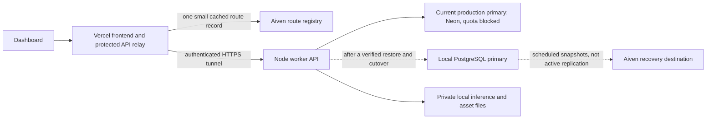

# Database operations · Neon, Aiven and local PostgreSQL

**Current status:** The owner chose a fresh operational database, and the platform is live again. See [Fresh start and current operations](FRESH_START.md). The source-recovery instructions below now apply only to optional recovery of the archived Neon history.

## Verified state · 9 November 2026

| Connection | Verified result | Current responsibility |
| --- | --- | --- |
| Local PostgreSQL 18.6 | Read/write transaction, 14 migrations, auth tables, RLS, export and restore checks | Loopback-only staging, automated tests, recovery destination |
| Aiven PostgreSQL 18.6 | CA-verified TLS read/write, 14 migrations, auth tables, restricted runtime role, export to local restore rehearsal | Cloud standby schema and a separate minimal worker-route registry |
| Existing Neon project | Rejects SQL with `53000`, quota exceeded | Still the authoritative production dataset; retained for recovery |

**The production workspace has not been imported into either standby. Publishing has not been restored by this database setup.** Standby dumps contain initialized schema and connection profiles, not the original accounts, Pages or delivery history. The restore command rejects these as production recovery input unless explicitly marked as a rehearsal.

The CLI reports November transfer of **5,669,991,071 bytes (5.67 GB)** and compute of **51,647 seconds (~14.35 CU-hours)**. Its consumption period ends **1 December 2026 at 00:00 UTC** (06:00 Bangladesh time). [Neon's Free plan includes 5 GB of public transfer per project/month; excess suspends compute](https://neon.com/docs/introduction/network-transfer). Deleting articles does not undo already transferred bytes. We did not delete production rows or purchase a plan.

## Architecture decision



Use **one primary writer**, not random database fallback. The preferred next step for this PC-hosted worker is local PostgreSQL as the operational primary, after restoring the original dataset. Article bodies, queue events, catalog processing, generation metadata and dashboard reads then travel over loopback. Aiven provides the public route registry and a future deliberate cloud recovery target. Neon can remain a secondary recovery/reporting destination after access resets. Full-database mirrors and frequent exports also consume transfer; do not continuously duplicate every event to all providers.

An empty cloud database is not failover. Automatic promotion requires synchronized data, a writer lease/fencing mechanism, matching asset storage and reconciliation of uncertain Meta/website deliveries. None is silently bypassed here. A PC failure also takes its private assets and inference offline unless they have independently available copies.

## Operator controls

The local build includes **Owner console → Databases**:

- Add/edit encrypted PostgreSQL profiles for local, Aiven, Neon or another PostgreSQL provider.
- Test a temporary read/write transaction and roll it back; inspect version, schema, migration count, latency and optional expiry.
- Observe process-local response-size estimates and frequently read query groups. Credentials, bound query values and article text are not retained in telemetry.
- Assign a client recovery or dedicated-database **candidate**. The assignment starts at `awaiting_snapshot`; it does not change live tenant routing.

Only the verified platform owner can use these routes. Tests cover ordinary-admin denial, tenant separation and secret redaction. Runtime tenant tables retain forced RLS; database profile tables are owner-only. **Dedicated live tenant routing is not implemented.** It needs consistent migration of tenant rows and global identity/billing relationships, plus isolated cutover tests. Profiles and staged assignments provide the operator configuration for that later work.

The new controls are tested locally. They have not been rolled out to the blocked production database. Migration `014-database-profiles-pulse.sql` must be applied to a recovered dataset before releasing the matching API/frontend.

## Private environment variables

Root and platform `.env.local` now keep named profiles without replacing the current `DATABASE_URL`:

```dotenv
NEON_DATABASE_URL=...
NEON_DATABASE_URL_UNPOOLED=...
AIVEN_DATABASE_URL=...
AIVEN_DATABASE_URL_UNPOOLED=...
AIVEN_SERVICE_ADMIN_URL=...
AIVEN_STANDBY_DATABASE_URL=...
AIVEN_STANDBY_DATABASE_URL_UNPOOLED=...
AIVEN_CA_CERT_PATH=C:\Users\bhnbi\Music\echolink\ca.pem
AIVEN_CA_CERT_BASE64=...
LOCAL_POSTGRES_DATABASE_URL=...
LOCAL_POSTGRES_DATABASE_URL_UNPOOLED=...
WORKER_REGISTRY_URL=...
WORKER_REGISTRY_WRITE_URL=...
WORKER_REGISTRY_PROVIDER=postgres
WORKER_REGISTRY_CA_CERT_BASE64=...
```

Normal Aiven access uses a non-superuser `creator_runtime` account. Unpooled/admin credentials are for schema setup/export only. Aiven certificate verification stays enabled using the downloaded project CA, as required by [Aiven's Node.js guide](https://aiven.io/docs/products/postgresql/howto/connect-node).

Vercel **production** now has sensitive server-only variables for `NEON_DATABASE_URL`, runtime `AIVEN_DATABASE_URL`, `AIVEN_CA_CERT_BASE64`, runtime `LOCAL_POSTGRES_DATABASE_URL`, and the reader-only `WORKER_REGISTRY_*` settings. Admin/migration URLs and registry writer credentials remain on the worker PC. No database credentials are frontend variables. Saving these values does not deploy code or change the active primary. Vercel's `127.0.0.1` is not this PC; local PostgreSQL stays private on port 55432.

The route reader can read only the route table, not tenant posts. The writer is separately scoped to updating that route. The updated supervisor writes at most once a minute; the updated Vercel resolver caches valid routes for a minute and failures for 15 seconds. Those code changes take effect after rollout/restart.

## Reproducible commands

```powershell
npm run db:connections
npm run db:local:start
npm run db:local:test
npm run db:local:browser
npm run db:measure
node scripts/backup-platform-db.mjs --profile=local
node scripts/backup-platform-db.mjs --profile=aiven
```

Setup/maintenance (credentials already configured; no plan purchase):

```powershell
npm run db:local:setup
npm run db:aiven:setup
npm run db:registry:setup
npm run db:env:vercel
```

Backups are private under `.codex/backups`. Preserve `PLATFORM_ENCRYPTION_KEY`, `BETTER_AUTH_SECRET` and media assets separately. A SQL dump alone cannot recover encrypted connections without the original encryption key.

## Transfer audit and implemented changes

Historical query statistics cannot be read while Neon rejects SQL. The following attribution is based on code inspection; it is not a measured per-query breakdown of November's bill.

| Pattern audited | Finding and action |
| --- | --- |
| Wide/unused columns | Dashboard lists repeatedly fetched complete article bodies, research excerpts, product descriptions and task histories. Lists now use compact projections and 20 recent task events. Editing a post or preparing manual product copy hydrates authenticated full detail first; stored text remains complete. |
| Pagination | Content list endpoints have bounded limits/offsets; state snapshots cap each content list at 300. Pulse caps recent/active tasks at 40. Owner global directory lists remain a scaling concern; move them to paginated search endpoints before a large public rollout. |
| Repeated static reads | A lightweight revision/task pulse replaces unchanged full-state polls. A full snapshot refreshes on content changes or after 60 seconds; hidden tabs stop polling. Owner state refreshes separately. Account provisioning updates only changed identity fields. Authorization and account suspension still check the database. |
| Application aggregation | Post counts and calendar summaries use SQL aggregates. Insight raw records are bounded to latest snapshots; detailed analytics on full state remain a further optimization candidate. No full-table in-memory count was introduced. |
| JOIN duplication | Workspace membership/activity joins match unique identities; no wide article-to-many-child join is used for lists. Research evidence is compacted within each row instead of multiplying it by source rows. |

Queue lanes previously checked every **1.5 seconds** even when empty. They now back off to **15 seconds** idle and **30–120 seconds** after errors; they remain serial within each lane. Scheduled publication can therefore start up to roughly 15 seconds after its due time when the publisher was idle, plus actual service latency. Generation and publishing remain independent. A task's internal progress can still update without downloading all article bodies.

Measured on 40 synthetic articles in local PostgreSQL, each with 26,000 body characters and three research excerpts:

```text
Original rows: 4,192,721 JSON bytes
Compact rows:    47,161 JSON bytes
Reduction:           98.9%
Stored full detail: unchanged
```

These are JSON response sizes, **not Neon wire/billing bytes** and not a promise that the whole application's transfer drops 98.9%. RSS downloads, model weight downloads and local inference do not pass through Neon; repeated database result reads do. [Neon's transfer guide](https://neon.com/docs/introduction/network-transfer) also explains why compressed `pg_dump` still consumes full outbound database transfer.

## Finish recovery and release

1. Obtain a complete recent production dump, or restore Neon source access once through Console/support or the monthly reset. The prepared standbys cannot supply inaccessible history.
2. Follow [Local PostgreSQL recovery](LOCAL_POSTGRES_RECOVERY.md), restore into a new database, retain keys, apply missing migrations and validate account/Page counts and delivery receipts.
3. Pause/drain the authoritative worker and reconcile `unknown`/in-flight website, Facebook, Instagram and comment submissions before allowing a replacement to publish.
4. Activate exactly one restored primary. For Aiven, set `DATABASE_CA_CERT_BASE64` and `DATABASE_POOL_MAX=2`; for the local primary use TCP/loopback. Keep separate migration credentials.
5. Start the matching API/frontend build, verify owner sign-in, all existing Page connections, calendar/editing and a controlled delivery. Deploy the Vercel frontend and route-registry update together with the compatible backend. Environment values alone do not make a release live.
6. Back up the **actual primary** daily to a separate protected disk, with occasional verified cloud copies and restore rehearsals. A backup of a staging schema is not evidence that production data is safe.

Your service's actual Aiven plan/expiry cannot be inferred from its PostgreSQL URI. Aiven's [indefinite free tier](https://aiven.io/docs/products/postgresql/concepts/pg-free-tier) is distinct from trial credits; it currently has 1 GB RAM, 1 GB disk and 20 maximum connections. Check the Console plan and expiry, then record the confirmed date in the database profile. No paid-plan change was made.
