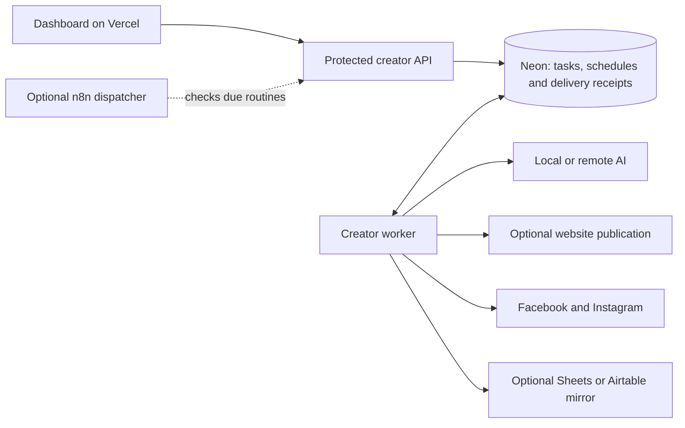

# EchoLink execution: n8n and the creator worker

Verified against the local code and services on 8 November 2026.

## Why the project started with n8n

The original request was an n8n-first news pipeline: fetch RSS, deduplicate,
call a local model, publish to Facebook and mirror records to Airtable. A visual
workflow was a reasonable fit for that scope. The original exports remain in
`workflows/`.

The product later expanded to public signup, isolated customer workspaces,
subscriptions, per-Page credentials, product catalogues, calendar editing,
image composition, website-first delivery and separate Facebook/Instagram
receipts. More of that logic was implemented in the custom creator backend.
The n8n workflow became an optional dispatcher rather than the full pipeline.
That was a substantial architecture change and should have been explained
before presenting it as the settled design. The original visual-workflow
requirement has not been fully delivered by the current fixed pipeline UI.

## What actually executes now

- `platform/server/jobs.mjs` claims and executes generation, creative,
  scheduling, publication, delayed-comment and reporting tasks.
- The worker checks due automation rules approximately once per minute. Its
  preparation and publication loops each check for eligible tasks every 1.5
  seconds. A check does not itself generate or publish a post.
- Task claims use PostgreSQL `FOR UPDATE SKIP LOCKED`; running tasks maintain
  heartbeats and leases. Publication has destination-specific receipts and
  an explicit unknown-outcome state requiring reconciliation.
- `platform/server/dispatch.mjs` accepts optional external dispatch checks,
  protected by a five-minute safeguard and an advisory lock.
- `platform/workflows/creator-platform.json` checks due rules every 15 minutes
  when activated. It does not contain all creator operations on its canvas.
- The Windows supervisor starts the creator worker, protected bridge and
  supporting services independently of n8n. A Windows login/startup process
  is not a cloud service or a guarantee of availability after every restart.

At inspection, port 5678 had no listener and all ten locally saved n8n
workflows were inactive. The newest saved n8n execution was dated 5 November.
The creator worker does not need `n8n start` to process its current queue.

## Efficiency and maintenance trade-offs

This compares a custom application engine with a workflow product. n8n also
runs on Node.js; changing the orchestrator does not inherently speed up AI,
image rendering, a website or Meta's API.

| Concern | Current creator worker | n8n as the primary engine |
| --- | --- | --- |
| Customer accounts, quotas, Page isolation | Shares the application's database and authorization rules | Still needs application authorization and careful credential/data routing |
| Approval versions and calendar reservations | Business rules are directly shared with the dashboard | Can call the same services, but ownership of state must remain explicit |
| Different Facebook/Instagram outcomes | Destination receipts are part of the domain model | Can implement this too; an execution log alone is not a delivery journal |
| Custom graphics and future video tools | Code can invoke libraries and separate rendering/model services | Nodes can invoke those services; heavy work still needs appropriate compute |
| Visual editing and debugging | Task console and fixed routines; no general-purpose graph editor | Mature visual editor and execution inspection |
| New third-party integrations | We implement and maintain adapters | Existing nodes can reduce integration work |
| Runtime footprint | No extra n8n process is needed | Adds another service; scalable queue deployments may add Redis and workers |
| Reliability work | We own retries, recovery, telemetry and upgrades | n8n supplies orchestration tooling; our domain-specific safeguards remain necessary |

No benchmark establishes that the worker is faster or cheaper. Its current
short polling interval also produces database traffic while idle. Adaptive
polling or explicit wakeups, measured queue latency, and bounded rendering
concurrency are useful future improvements. Removing a service that is already
stopped saves no additional runtime resources today.

The present worker's task locks do not establish a fully tested cloud/PC
failover system. Shared assets, worker ownership fencing, routing and recovery
tests are required before operating it as a redundant deployment.

## If n8n is removed completely

Current v2 generation and publication can continue without the inactive n8n
installation. What would be removed is the optional dispatch integration,
visual editor access and legacy workflows, not the creator task engine.

A deliberate removal should:

1. Back up workflow exports, the stopped n8n database, configuration and its
   credential encryption key securely. Never commit decrypted credentials.
2. Remove or hide the optional n8n connection/control surfaces and dispatcher
   scripts so the dashboard no longer suggests it is a required dependency.
3. Verify worker startup, due-rule checks, scheduling, delivery recovery and
   delayed comments without n8n. Preserve one publishing owner.
4. Uninstall n8n only after that verification; retain a protected recovery copy.

No n8n installation or saved workflow was deleted during this assessment.

## Recommended direction

Use the custom creator worker as the core product engine and improve its
visible pipeline controls. Retain n8n only as an optional external integration
if its visual editor or connectors are useful. Moving everything back into
n8n is possible, but requires a deliberate orchestration redesign with one
source of truth; activating the old pipeline would risk conflicting delivery.

For future YouTube/video work, separate scripts, voice, rendering and upload
into durable stages with appropriate compute and progress reporting. Neither
orchestrator supplies GPU capacity, model quality or monetization eligibility.

n8n's current licensing guidance distinguishes internal workflow authorship
from customers configuring workflows, including through a custom interface.
The latter requires a commercial license. Merely letting clients connect
accounts to internally authored workflows is described as allowed under its
Community license. Review the actual intended builder against the
[official licensing guidance](https://support.n8n.io/article/can-i-use-your-license-for-my-use-case)
before embedding n8n in a public automation-builder product.

See [Oracle migration status](ORACLE_MIGRATION.md) for the actual cloud launch
result and the work required before replacing the Windows worker.
