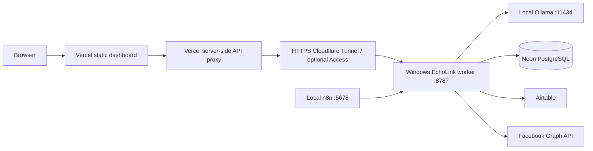

# Hosting EchoLink: Vercel dashboard with local n8n and free local AI

Checked 2026-11-03. Deployment files are prepared under `deploy/vercel/`.
The dashboard is deployed at https://echolinkbd.vercel.app/admin with a
restricted local bridge and a temporary HTTPS tunnel. See [CI_CD.md](CI_CD.md)
for current deployment, GitHub Actions authorization and tunnel restart steps.
No cloud VM has been created; n8n, the worker and models remain on Windows.
For the current tested commands, use [PRODUCTION_TESTING.md](PRODUCTION_TESTING.md).
The longer hosting examples below describe alternatives, including a named
tunnel; the current public tunnel targets the restricted bridge on port 8788.

## Which parts can be hosted where?

| Setup | Suitable use | Limitation |
| --- | --- | --- |
| Everything on this Windows PC | Simplest initial setup; local n8n/worker/Ollama, cloud Neon/Airtable | PC, network and services must remain running. No hosting charge for those local processes; power/network and external service quotas still apply. |
| Vercel frontend + local worker through a tunnel | Remote dashboard while keeping inference local | Vercel cannot call your PC's localhost directly. An HTTPS route to the worker is needed; automation still stops when the PC is off. |
| Vercel Functions for the current full worker/n8n | Not a drop-in deployment for this project | Current n8n is a persistent process; the worker writes local settings, reads n8n SQLite and needs local model connectivity. Functions have request/runtime constraints and do not provide your Windows disk/model. |
| Render free web service | Demos of a redesigned HTTP app | Free services sleep after 15 minutes without inbound traffic and have ephemeral filesystems; unsuitable for this current scheduled n8n/SQLite setup. |
| Oracle Always Free VM, if available | Possible persistent Linux host for n8n + worker, with a CPU model if resources permit | Account/region capacity, quota and idle-instance reclamation apply. An x86/ARM-compatible deployment and different OS paths/setup are needed. It is not a guarantee of an available GPU or production uptime. |

Vercel Hobby is for personal/non-commercial use. A revenue-generating Page
automation should not assume eligibility for that plan. Hobby Functions currently
have a 300-second maximum with Fluid compute; Hobby Cron runs at most once per
day. Our one-minute tick therefore stays in local n8n. The static frontend does
not perform AI inference or own the scheduler.

Sources: [Vercel Hobby](https://vercel.com/docs/plans/hobby),
[Function limits](https://vercel.com/docs/functions/limitations),
[Cron limits](https://vercel.com/docs/cron-jobs/usage-and-pricing),
[Render free services](https://render.com/docs/free),
[Oracle Always Free](https://docs.oracle.com/en-us/iaas/Content/FreeTier/freetier_topic-Always_Free_Resources.htm).

## Architecture of the prepared deployment



In a Vercel Function, `localhost` is Vercel's environment. In a remote phone's
browser, `localhost` is that phone. Neither reaches your PC. The Vercel proxy
must use a real HTTPS tunnel hostname. Do not change the model URL to a Vercel
URL: the worker still calls Ollama locally on Windows.

The browser uses `/admin/api/...` on the Vercel domain. A server-side function
forwards only allowed dashboard endpoints to the tunnel and forwards the
HttpOnly session cookie back to that same Vercel domain. POST requests must
match the exact configured dashboard origin. Public sessions use Secure cookies.
Worker job endpoints and owner-ticket creation are excluded from this proxy.
No wildcard CORS or browser-readable worker token is required.

Local n8n continues calling `http://127.0.0.1:8787/jobs/...`; scheduled posts do
not travel through Vercel. Facebook publishing is outbound HTTP, so this news
workflow does not require exposing local n8n or Ollama to Facebook.

## 1. Confirm local operation first

Follow [FIRST_FACEBOOK_POST.md](FIRST_FACEBOOK_POST.md). Confirm model generation,
Page identity and dry-run review before deploying the frontend.

The worker already supports `DASHBOARD_PASSWORD` from `.env.local`. Set that
variable or create a hashed password in Settings. Keep database URLs, Airtable
PAT, Facebook token maps, worker key and n8n API key on the local worker.

## 2. Give the local worker an HTTPS hostname

Install Cloudflare's `cloudflared` connector for Windows using its official
[downloads guide](https://developers.cloudflare.com/cloudflare-one/networks/connectors/cloudflare-tunnel/downloads/).
Then choose a temporary test tunnel or a stable named tunnel.

Temporary demonstration, no custom domain:

```powershell
cloudflared tunnel --url http://127.0.0.1:8787
```

This prints an HTTPS `trycloudflare.com` hostname. Keep that process open. The
hostname is temporary and changes when a new tunnel is started; use it only for
a demonstration. A working dashboard password is required before exposing the
worker this way. Quick Tunnels are for testing and have additional limitations:
https://developers.cloudflare.com/tunnel/get-started/quick-tunnels/

For continued use, follow the official
[named tunnel setup](https://developers.cloudflare.com/tunnel/get-started/):

1. Sign into Cloudflare; use a domain you control for a stable hostname.
2. Create a tunnel and install/run its Windows connector as instructed.
3. Configure the published hostname, e.g. `worker.example.com`, to the HTTP
   service `http://127.0.0.1:8787`. Do not use ports 5678 or 11434 here.
4. For a protected deployment, add a Cloudflare Access self-hosted application
   covering that hostname and a **Service Auth** policy accepting a service token.
5. Create that service token; its client ID and secret go only in Vercel's
   server-side environment variables. Access must actually enforce this policy;
   creating a token by itself does not protect the tunnel.

See [Cloudflare service tokens](https://developers.cloudflare.com/cloudflare-one/access-controls/service-credentials/service-tokens/).
The named-domain registration may have a separate cost; it is not included in
the claim that local software or a hosting plan is free.

## 3. Build and create the Vercel project

From the EchoLink project root:

```powershell
npm run build
cd deploy\vercel
npx vercel
```

The root build copies the current UI to `deploy/vercel/public/admin`. Only this
deployment folder is needed on Vercel; it contains its own package/config/API
function. Its build also works when the parent source tree is absent, using the
copied assets. After UI changes, run the root build before redeploying.

When prompted, use your Vercel account and create/select a dashboard project.
The first sign-in/project selection is your account action. Alternatively, use
a Git repository and set the Vercel **Root Directory** to `deploy/vercel`.
This workspace is currently not a Git repository; Git deployment first requires
you to create/push one. Do not commit `.env.local`.

Project settings:

| Setting | Value |
| --- | --- |
| Framework | Other / no framework |
| Root directory | `deploy/vercel` for Git, or run CLI from that directory |
| Build command | `npm run build` |
| Output directory | `public` |
| Node runtime | A supported Node 22+ runtime |

Use the stable production domain, e.g. `https://echolink-dashboard.vercel.app`.
An initial deployment can serve the sign-in page before the proxy is configured;
sign-in will work after adding the environment variables below and redeploying.
Varying preview URLs are not automatically authorized origins.

## 4. Set the two sides' environment variables

In the Vercel project settings, add **server-only** Production variables:

```dotenv
WORKER_ORIGIN=https://worker.example.com
DASHBOARD_PUBLIC_ORIGIN=https://echolink-dashboard.vercel.app
# Only if Access protects your worker hostname:
CF_ACCESS_CLIENT_ID=your-service-token-client-id
CF_ACCESS_CLIENT_SECRET=your-service-token-secret
```

Use your actual tunnel and Vercel hostnames, with no path/trailing slash. For a
temporary demonstration, WORKER_ORIGIN is the current HTTPS trycloudflare hostname.
Redeploy when these variables change; Vercel deployments capture their values.
Do not use NEXT_PUBLIC_/VITE_ prefixes or copy database/Facebook credentials into
the static frontend.

On Windows, append/update this one variable in the existing root `.env.local`:

```dotenv
DASHBOARD_PUBLIC_ORIGIN=https://echolink-dashboard.vercel.app
```

Keep HOST=127.0.0.1. The connector running on this PC reaches that loopback
service. Keep N8N_BASE_URL=http://localhost:5678 and the existing local model URLs.
Restart only the EchoLink worker after saving:

```powershell
cd C:\Users\bhnbi\Music\echolink
.\scripts\restart-worker.ps1
```

In `deploy/vercel`, deploy the configured production frontend:

```powershell
npx vercel --prod
```

If you use the CLI to add credentials, enter them at its prompt rather than
placing their values in command arguments/history. Account access, domain setup,
tunnel connector installation and entering the selected production origin are
manual parts; no public deployment has already been performed for you.

## 5. Verify the remote dashboard

1. Open `https://YOUR-PRODUCTION-DOMAIN/admin`, including from another device.
2. Sign in with the same dashboard password. Local and Vercel hostnames have
   separate cookie jars; the owner login command opens the local dashboard.
3. Check page/feed counts and Settings. Test Neon/Airtable from the dashboard.
4. While still in dry-run, verify Workflow Start and Stop; leave the schedule
   stopped until the first-post walkthrough is complete.
5. Confirm browser requests go only to the Vercel `/admin/api/...` URLs. The proxy
   handles the tunnel and optional Access credentials server-side.
6. The current **Open n8n** link still points to localhost. It opens the editor
   on the host PC, but not on a remote phone. Remote editor access needs a
   separately protected VPN/tunnel route. Dashboard Start/Stop already works
   through the worker, so exposing the editor is optional.

The proxy has a 245-second request timeout, inside the Hobby Function budget.
Long CPU caption tests should be run from the local dashboard; normal scheduled
AI processing stays in n8n and is unaffected by that Vercel request timeout.
A timeout does not cancel a remote action or prove it failed; inspect queue
status before repeating publishing-related operations.

## Operating limits and troubleshooting

- The Vercel page can load when your PC is asleep, but its API controls cannot
  reach a stopped worker. Hosting the frontend does not make local automation
  available 24/7.
- A 502 proxy response: check worker, internet, tunnel, WORKER_ORIGIN and Access
  service credentials/policy. An Access HTML sign-in page is not worker JSON.
- A 403 at login/save: exact DASHBOARD_PUBLIC_ORIGIN must match the browser's
  production HTTPS origin on both Vercel and Windows. Restart/redeploy after edits.
- A temporary tunnel restart requires updating WORKER_ORIGIN and redeploying.
- The proxy does not return credentials. Password creation still writes the
  local `.env.local`; it is not trying to write Vercel's read-only deployment disk.
- Do not expect a remote n8n/VM to reach your PC's Ollama using its own localhost.
  Moving n8n/worker to a VM requires a private route to local inference, or a model
  running on that VM, plus a persistent n8n database and encryption-key backup.

For the first real post, the all-local setup is the fewest moving parts. The
Vercel split can be enabled later without moving the scheduler or the model.
