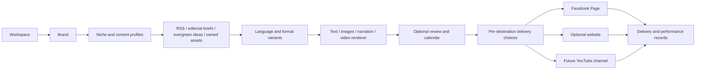

# EchoLink: multi-niche creator operations platform

Updated 2026-11-06. This is the product direction and phased implementation plan,
not a claim that the planned adapters or revenue streams already work.

## Product direction

One owner can manage several brands, niches, Facebook Pages, websites and future
YouTube channels. Each destination has its own language, content mix, brand kit,
model routing, schedule, approval preference and optional website connection.
News is the first working content module; RSS is one source adapter rather than
the definition of the entire product. Preserve its seven original acceptance
criteria and verified publishing behavior during the refactor.

## Configuration hierarchy

| Object | Configuration and responsibility |
| --- | --- |
| Workspace | Owner/team access, timezone defaults, connection aliases, billing/compute budgets and retention |
| Brand / niche | Audience, content pillars, brand identity, editorial stance, allowed sources and preferred formats; multiple niches per workspace |
| Destination | Facebook Page, website or YouTube channel; separate credentials, enabled state, limits and publication status |
| Content profile | Topic, language, tone, format, prompt version, source strategy, model assignments and quality rules; one Page can use multiple profiles |
| Brand kit | Logo, favicon, colors, Bangla/English fonts, image overlay, aspect ratios, thumbnail and subtitle presets |
| Campaign / series | Goal, themes, start/end dates, reusable briefs and content mix; optional commercial disclosure and tracking |
| Content item | Canonical idea/story, evidence, ownership/asset rights and source history |
| Variant | Language, script, caption, title, image/video assets and revision-specific approval |
| Delivery | Independent website/Facebook/YouTube record, schedule, remote ID, retry state and performance |

Use BCP-47 language codes with configurable tone, spelling, script, numeral style,
timezone and voice; retain Bangla/English/Bilingual compatibility during migration.
Do not create separate copies of the scheduling engine for each niche or language.

## Content modules

| Module | Inputs | Initial outputs | Later formats |
| --- | --- | --- | --- |
| News | Verified RSS, permitted extraction and editor-selected stories | Factual rewritten captions, source photos/text and optional website summary | Original narrated explainers and periodic roundups |
| Quotes / motivation | Original writing, licensed collections or verified attribution | Branded quote image plus caption; abstract art | Short narrated reflections with distinct scripts and scenes |
| Education / skills | Owned lesson briefs, documentation and researched sources | How-to posts, diagrams, fact cards and mini lessons | Tutorials, screen recordings and longer explainers |
| Technology / tools | Tested products, owned demos and release sources | Demonstrations, comparisons and tips | Original reviews, walkthroughs and disclosed affiliate content |
| Storytelling / entertainment | Original scripts and characters, licensed assets | Illustrated micro-stories and episodic posts | Narrated story videos and original short animations |
| Commerce / local services | Owner's catalog, offers, FAQs and expertise | Product/offer images, FAQs and case studies | Demonstrations, customer-authorized stories and service explainers |

Separate **content type** (news, tutorial, quote, story, offer) from **post format**
(text, photo, multi-image/carousel where supported, short video, long video or
website article). Quote attribution must be verified or the text presented as
original writing; do not invent a famous author's endorsement. Image prompts do
not establish image rights or claim a real event was photographed.

## Website and link choices

Each Page will have independent controls:

1. **Website connection:** none, NobleSeek or another installed adapter.
2. **Publish to website:** on/off. A Facebook-only Page needs no website credentials.
3. **Publish to Facebook:** on/off. A website-only delivery needs no Facebook token.
4. **Automatic link sharing:** off/on, separate from website publication. Current
   owner choice is **off**; do not automatically add source/website link comments.
5. **Delivery order:** independent by default; website-first when a Facebook link
   depends on the newly published website URL. Only a required dependency may
   hold another destination; an optional website outage must not stop Facebook.

The first NobleSeek connector uses an explicit Facebook Page allowlist. A later
connection picker and per-Page destination records replace that bootstrap config.
Saved article URLs remain visible and copyable even when automatic sharing is off.
Manual approved captions are not silently rewritten. Linking stays disabled until
the owner changes it; do not suggest comment placement as a workaround for a cap.

## Smooth publishing without arbitrary restrictions

- Keep Publish Now, Save Draft, Approve, Schedule and retry actions direct and
  show the actual result. Approval is a Page/profile choice, not mandatory for
  every quote, image or channel. News fact warnings use the selected validator;
  news-specific number checks must not be imposed blindly on every niche.
- Enforce the owner's posting window, daily cap, spacing and enabled state.
  Preserve the current Page's saved values; do not raise volume automatically.
- Deduplicate by destination and relevant time horizon. Permit deliberate
  language/format variants and editorially meaningful updates with clear history.
- Respect actual Meta usage headers, Retry-After and credential/policy pauses.
  Do not turn unverified figures such as 35 posts/day or a universal two-links
  quota into fixed platform limits. A paid plan does not remove spam policies.
- If the owner enters a Page-specific link allowance, track known usage and allow
  manual reconciliation of posts made outside EchoLink. Do not label a locally
  calculated count as Meta's authoritative remaining quota.
- Retry deterministic preparation safely; preserve ambiguous-outcome holds on
  external publication. Those holds prevent duplicate posts after a timeout.
- Share a content library and per-platform variants, not an indiscriminate blast
  of identical content to every account. Native photo/text remains available
  without link comments, website dependency or a generative-image service.

Meta says flooding Feed, unrelated captions and excessive hashtags can reduce
reach/monetization, and it is emphasizing original content. The sources do not
establish a guaranteed safe daily publishing threshold. [Meta spam guidance](https://about.fb.com/news/2025/04/cracking-down-spammy-content-facebook/),
[Meta original-content guidance](https://about.fb.com/news/2026/03/rewarding-original-creators-on-facebook/amp/).
The current link-limit help URL redirected to login during research; applicability
and allowance must be checked on the actual Page. [Meta link help](https://www.facebook.com/help/1929252614431792).

## Revenue experiments and measurement

The following are business hypotheses to test, not guaranteed earnings or a list
of proven highest-paying niches. Start with a niche where the owner can add
expertise, original examples and credible source material.

| Experiment | Automation support | Measure before scaling |
| --- | --- | --- |
| Original explainers / tutorials | Research briefs, script drafts, diagrams, subtitles and native publishing | Retention, returning viewers, qualified views and production time |
| Demonstrations / product education | Catalog sync, owned demos and disclosed affiliate tracking | Attributable clicks, conversions, returns and net contribution |
| Newsletter / owned website | Optional article variants, email-ready drafts and opt-in signup tracking | Returning readers, opt-ins and actual website revenue |
| Sponsorship-ready niche series | Brand-consistent series, media-kit exports and explicit sponsorship labels | Audience fit, inbound enquiries and realized sponsorship value |
| Services / digital products | FAQ series, educational content and CRM lead records | Qualified leads, sales and fulfillment cost |

Add a performance notebook with content format, hook, language, topic, publication
time, watch time, engagement, clicks, conversions and actual revenue where the
provider exposes it. Support manual/CSV imports when an API does not. Compare
revenue and results with rendering time, energy/hosting spend and editorial time.
Use approved experiments and minimum evidence before recommending a new cadence;
do not auto-maximize posting frequency or promise reach, monetization or income.

Meta's 2026 creator update emphasizes original content, longer watch time and
qualified views. This supports testing useful original formats, not a claim that
more automation produces more earnings. [Meta creator update](https://about.fb.com/news/2026/03/creator-fast-track-grow-your-audience-earn-money-on-facebook/amp/).

## Local media and future YouTube pipeline

Current machine inspection: Windows 11, 12 GB RAM, NVIDIA GT 730 (2 GB VRAM) plus
Intel HD 530. Text inference currently runs slowly on CPU. A modern generative
video model is not a practical production baseline for this GPU. Keep media jobs
on a separate bounded worker so rendering cannot block Facebook scheduling.

| Capability | Planned tool/adapter | Acceptance and limits |
| --- | --- | --- |
| Scripts, captions and translations | Existing Ollama / LM Studio / LocalAI adapter; optional paid model routing | Per-language factual/creative evaluation and timing; preserve evidence |
| Quote cards and branded visuals | SVG/Sharp-style renderer, typography and asset templates | Fast CPU path; Bangla shaping, readable type and reviewed output |
| Generated illustrations | ComfyUI-compatible workflow or another local inference adapter | Benchmark a license-compatible model against actual RAM/VRAM before enabling; optional paid GPU fallback |
| Narration | Kokoro for supported languages; evaluate Indic Parler TTS for Bangla | Native-speaker quality and timing test; model and voice licenses recorded |
| Composition | FFmpeg, captions/subtitles, scene timeline, music ducking and thumbnail renderer | Original narration/visual explanations; 9:16, 1:1 and 16:9 exports |
| Speech alignment / captions | Local speech recognition/alignment adapter | Bangla timing/readability verification; no claim that every voice/language is ready |
| Generative video | Evaluate current LTX and Wan adapters on a suitable GPU worker | Future hardware/optional hosted compute; no large video weights downloaded on this PC now |
| YouTube delivery | OAuth channel connections and resumable Data API upload | Private test upload first, then owner-chosen visibility/schedule, metadata and disclosure |

Indic Parler's model card lists Bengali and an Apache-2.0 license; Kokoro's card
lists its supported languages and Apache licensing. These are candidates, not
installed or validated narration engines. Code licensing and model/voice/music
licensing are separate. Some free TTS checkpoints have noncommercial terms and
must not be selected for a monetized channel merely because their code is open.
[Indic Parler TTS](https://huggingface.co/ai4bharat/indic-parler-tts),
[Kokoro](https://huggingface.co/hexgrad/Kokoro-82M).

The official Wan 2.2 5B example specifies at least 24 GB VRAM for its documented
720p command. LTX offers local workflows and offloading, but those do not prove
acceptable speed or compatibility on a GT 730. Re-evaluate versions, weights,
licenses and memory requirements when implementing the GPU worker.
[Wan](https://github.com/Wan-Video/Wan2.2), [LTX](https://github.com/Lightricks/LTX-2).

The video pipeline is: brief → research/original script → scene plan → owned or
licensed visuals → narration → subtitles → composition → QC/preview → channel
variant → upload → analytics. Keep checkpoints and resume individual stages.
Private upload is a technical test, not proof of monetization eligibility.

YouTube requires original, authentic value for monetization; low-value slideshows,
templated stories and mass-produced repetitive content can be ineligible. A
rewritten article read aloud over unrelated clips is not the monetization target.
The creator should add explanation, demonstration, narrative or substantive
commentary, and review actual channel eligibility in Studio. [Monetization policy](https://support.google.com/youtube/answer/1311392?hl=en-GB),
[YPP eligibility](https://support.google.com/youtube/answer/72851?hl=en).
Realistic synthetic/meaningfully altered content needs the applicable disclosure
during upload. [YouTube disclosure guidance](https://support.google.com/youtube/answer/14328491?hl=en).

## Data and workflow architecture

Retain Neon as canonical state and existing Airtable/Sheets mirrors. Add new
tables incrementally: `workspaces`, `brands`, `content_profiles`, `destinations`,
`destination_profiles`, `website_connections`, `brand_kits`, `assets`,
`content_items`, `content_variants`, `deliveries`, `render_jobs`, `campaigns`,
`performance_snapshots` and `revenue_events`. These are planned names, not tables
already provisioned. Migrate existing Pages/articles into compatibility views or
adapters before changing working API contracts. Separate tenant IDs from Page IDs.

Credentials stay server-side under connection aliases. Asset metadata carries
source/license/credit, language, aspect ratio, model/prompt version and content
hash. Store large media in object storage or a managed local asset directory,
not Airtable long-text or SQL blobs. Approval binds the reviewed caption and exact
media revision. Deliveries have unique variant/destination keys, independent
remote outcomes and durable retries; a successful website post is not a successful
Facebook or YouTube delivery.

Keep the single n8n operations canvas as the orchestrator. Dispatch to modular
source, generator, renderer, validator and publisher workers by content profile.
Do not duplicate 20 RSS nodes for every niche or build a monolithic agent that
owns credentials and can publish unrestricted tool output. MCP/provider adapters
remain optional plugins with explicit capabilities, timeouts and budgets.

Preserve the earlier provider backlog: Facebook Pages MCP, self-hosted Postiz and
its MCP adapter for additional networks, Qdrant/vector-memory adapters, paid
Bright Data/Decodo extraction where appropriate, and S3-compatible media storage.
They are not required to publish a native Facebook photo/text post. Verify each
actual package, transport, supported tools, credentials and pricing when wiring
it; do not label an untested package as an installed connection. Existing account
and integration gaps remain listed in [PRODUCTION_TESTING.md](PRODUCTION_TESTING.md).

## Implementation order and acceptance

| Phase | Deliverable | Evidence required |
| --- | --- | --- |
| 0 — Finish current extension | Optional NobleSeek PostgreSQL publishing, Page allowlist, automatic links off, clear destination states | Disposable-branch website-first/independent delivery tests; real connection and rolled-back draft probe; working dashboard visibility; user-disabled Page preserved |
| 1 — Platform foundation | Niche/content profiles, multi-Page languages/formats, per-Page destination toggles, model capabilities and scheduling policies | Two Pages with different profiles/languages; isolation, draft/approve/schedule/Publish Now paths; one Page works without a website |
| 2 — Creative assets | Brand kits, favicon/logo/watermark, quote-card and caption outputs, asset library and media previews | Exact reviewed image published; Bangla/English render checks; image failure is visible; no fabricated attribution |
| 3 — Creator operations | Campaign/series planner, content mix, reusable briefs, bounded batch drafting and content recycling rules | Distinct purposeful variants, revision history, calendar controls and accountable metrics; no automatic posting-volume escalation |
| 4 — YouTube MVP | Original scripted video, narration, subtitles, FFmpeg render, thumbnail and private upload | One original Bangla and one English pilot; measured render time/storage; reviewed captions/audio; OAuth and resumable upload proof |
| 5 — Advanced video | Suitable GPU/hosted workers, LTX/Wan evaluation, scene continuity, dubbing and multi-format repurposing | Real hardware benchmark, model/license review and useful output quality; optional cost limits enforced |
| 6 — Growth and teams | Performance/revenue experiments, role permissions, alerts, named tunnel/startup and backup/restore | Multi-tenant authorization tests, actual metrics/imports, recovery drill and measured business outcomes |

Stages may overlap for independent work. Finish and prove an adapter before
presenting it as a plug-and-play connection. Website/YouTube authorization,
commercial accounts, content rights, additional hardware and final creative
choices remain the owner's parts. The agent handles code, migration validation,
connection probes, workflow wiring, documentation and test evidence.

## Next releases: format-aware multi-channel scheduling

| Release | Deliverable | Acceptance before enabling |
| --- | --- | --- |
| Current update | Price-free product creatives, verified fabric callouts, category-based catalogue search, randomized category rotation, priority preparation, category-balanced news, real task console, separate Instagram photo deliveries | Tenant isolation, current-version scheduling, signed JPEG expiry and duplicate-publication protection; per-Page opt-in |
| Next: Text and Image mixes | Separate post format from editorial type; weighted or rotating Text/Image slots, per-format prompts and daily goals, reusable layout presets and template previews | Text posts need no image task; every image slot waits for its own completed asset; editing a mix leaves already-published deliveries untouched |
| Next: Reels preparation | Verified script, scene list, local narration/subtitles, licensed music, product/photo motion templates and CPU FFmpeg rendering; optional capable local/cloud video adapters | Render queue has independent resource limits; real MP4 codec/duration/aspect checks; progress from the renderer; usable preview before scheduling |
| Next: Reels delivery | Instagram/Facebook container upload, processing checks and durable delivery records, platform-specific captions and covers | Permission checks against the actual account, resumable upload, lost-response reconciliation, no fake success or duplicate publication |
| Later: YouTube channels | Original long/short scripts, thumbnail and chapter variants, local media assembly, channel-specific OAuth, upload and analytics | Real OAuth consent, upload quota checks, ownership/licensing records and separate per-channel scheduling; reused news text alone is not treated as original video value |
| Later: Performance-guided mixes | Compare actual measured retention, messages, leads and purchases; propose a different mix by niche | Minimum samples and explicit opt-in; record costs and results; no guarantees of virality, revenue or reach |

Post-format choices will be separate from content types such as news, product
sale, quote and tutorial. A Page may select a mix such as Text 20%, Image 60%,
Reels 20%; these are user preferences, not a recommendation or a claim that Reel
publishing is implemented today. Each channel gets its own delivery state and
format checks. Website posting remains optional for every Page, and RSS stays
exclusive to news Pages. Instagram photo sharing now uses the professional account
linked through the existing Facebook Page authorization. Reels and personal
profile API posting are not enabled by that photo adapter.

## November channel and hosting update

Implemented: linked professional Instagram image delivery after Facebook, a shared intended calendar slot, independently generated/editable channel captions and Page styles, adaptive transparent product logos with optional contrast variants, per-variant widths, concise product headlines and corner handles around a website badge. Source-link comments remain opt-in and currently disabled.

Next: choose destinations per content item (including Instagram-only workflows), optional channel-specific image crops/carousels, Reels rendering with licensed audio and measured upload status, mixed-format Page routines, content experiments based on measured insights, and YouTube video pipelines after local hardware/runtime benchmarks. Simultaneous publication to two external APIs is not a guarantee.

Infrastructure: [Oracle assessment](ORACLE_HOSTING.md) verifies the current 2-OCPU/12-GB Always Free A1 allocation. A tested Linux worker package, portable asset storage/path migration, private model networking and restore verification precede any Windows-to-Oracle cutover. n8n hosting alone does not remove the worker’s PC dependency.

## 7 November operational update

Implemented: source-grounded product profiles and specification callouts, technical/fashion typography, durable five-minute Facebook link comments per Page, NobleSeek subdomain migration, Facebook/Instagram account reports with availability labels and CSV export, and Page profile/cover drafting with explicit Facebook application. Airtable remains an optional mirror; Neon and the dashboard provide primary management.

Implemented on 7 November: reference-based dark news layout with configurable headline highlights, website-first public API verification, independent destination receipts, visible failed-delivery queue and interval-mode scheduling.

Next: broader structured catalog adapters; measured product-spec coverage; reporting pagination and controlled scheduled snapshots; richer media-level Instagram analytics; shared/object-storage asset portability; Instagram-only delivery choices; carousel/Reels variants and YouTube rendering benchmarks.
