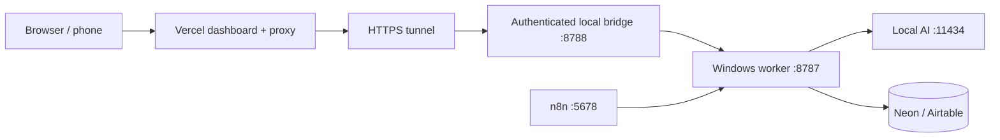

# Public dashboard, local AI and remaining work

November 4 quality update: controlled 4B tests still produced unsupported details.
The candidate prompt remains diagnostic-only. Production retains its existing
prompt with additional review signals; the post editor now allows correcting
editorial notes. Read [caption quality findings and diagnostics](CAPTION_QUALITY.md)
before treating valid output as factually verified or changing the review policy.

Open **https://echolinkbd.vercel.app/admin** and use the existing local
`DASHBOARD_PASSWORD`. The November 4 outage was an expired Cloudflare Quick
Tunnel: the old hostname stopped resolving and cloudflared reported
`Unauthorized: Tunnel not found`. The worker and Ollama were healthy. The tunnel
was replaced, Vercel settings updated, and the dashboard redeployed.

## How local AI connects



The worker on your Windows PC interprets the model URL. Keep
`http://localhost:11434/v1/chat/completions` even when opening the dashboard
from a phone. Vercel forwards commands; it does not run the model. Ollama
supports this [OpenAI-compatible endpoint](https://github.com/ollama/ollama/blob/main/docs/api/openai-compatibility.mdx).
Only the restricted bridge is tunneled; public Ollama/n8n endpoints are not needed.

## Keep the Windows services running

```powershell
Set-Location C:\Users\bhnbi\Music\echolink
ollama list
npm run public:check
```

Expect PASS for Worker, Bridge, HTTPS tunnel, Public dashboard, Ollama and n8n.
Launch the Ollama Windows app if stopped. If its tray app is already serving,
do not start a second `ollama serve`. Start n8n with `n8n start` in another
terminal if needed. To recover worker/bridge/tunnel and redeploy their settings:

```powershell
npm run public:repair
```

This uses the saved deployment token and Vercel CLI 65.4.0; it starts worker/bridge if
needed, replaces the temporary tunnel, updates three encrypted Vercel variables,
builds, deploys and checks connectivity. It does not activate n8n or enable live
posting. On a new installation install the pinned CLI with
`npm install --global vercel@65.4.0`. Run recovery on this PC, not in Vercel's terminal.

Keep the PC awake and online. A GitHub push updates frontend/proxy code; local
worker changes need a local pull/build/restart. Avoid restarting during a run.
Windows automatic-start tasks have not been installed.

## Configure and test the Page

In **Pages & models**, choose Noble Seek:

| Field | Setting |
| --- | --- |
| AI Infrastructure Target | Ollama |
| Local Endpoint URL | `http://localhost:11434/v1/chat/completions` |
| Model Identifier | `echolink-gemma3:4b` |
| Temperature | `0.3` |
| Target Language | Bangla |
| AI Secret Alias | Blank for this local Ollama server |
| Require Human Approval | Enabled |
| Timezone | `Asia/Dhaka` |

Save, click **Discover models**, then **Test caption**. The test requests one
short diagnostic sentence to fit public HTTP timeouts on this CPU. It checks
connectivity, not article quality. Full article generation runs in the background.

All three models are installed: `gemma3:1b`, `gemma3:4b`, `echolink-gemma3:4b`.
The configured profile has 8192 context. To recreate it on a new installation:

```powershell
ollama pull gemma3:4b
ollama create echolink-gemma3:4b -f config/Modelfile.gemma3-4b
```

For LM Studio or LocalAI, use the server's full OpenAI-compatible chat URL and
exact loaded model ID. Add a non-local hostname to allowed AI hosts and save
any key under an AI secret alias. If the worker itself moves into Docker,
`host.docker.internal` can reach a Windows-hosted model. Moving only n8n into
Docker does not change a Windows-native worker's model endpoint.

## Test today's draft safely

1. For a fresh safe test, choose **DRY RUN** in Settings deliberately. The saved
   installation is currently in live mode with the Page disabled by the user;
   do not assume it is already a dry-run environment. A disabled Page blocks
   generation/publishing until the user enables it. The single n8n pipeline is
   active, but it cannot publish to a disabled Page.
2. On Overview choose the Page, then **Generate today's top draft**. Twenty
   verified feeds are enabled for the Page; the BBC example remains paused.
3. Watch **Activity**. Background CPU inference can take minutes and continues
   independently of the browser. Inspect blocked/failed results before retrying.
4. Open **Drafts**. Check source/date, selection reason, caption, analysis,
   image candidate and illustration suggestion.
5. Compare numbers, names and attribution with the source. The prior 4B draft
   had contradictory polling figures and is flagged. Unapproved captions with
   an explicit editorial warning or unsupported numeric values now require
   review even on automatic Pages. This does not establish accuracy. Edit before
   approving; edits revoke previous approval. Existing human approvals are kept.
6. Check permission to reuse a source image, or choose text-only. An image
   suggestion is not a generated or licensed image.

“Top today” means ranked among enabled feeds using source dates, recency,
related coverage and topic signals; it is not a verified national trending chart.
Older drafts stay visible. Items with no known source date are not called today.

## First real Facebook post

The saved NobleSeek token and Graph API version are now working, including
publishing and engagement permissions. A real photo post and delayed source
comment were verified directly through Meta on November 4. On a new setup or
after a credential change, save the Page token under the alias matching the
Page's **FB Secret Alias**, save a supported Graph API version and run
**Test Facebook connection** to check identity and publishing permissions.

After editorial/media review, follow [FIRST_FACEBOOK_POST.md](FIRST_FACEBOOK_POST.md)
for all 21 n8n nodes and the single-post test: deliberately enable live mode,
approve one item, check quiet hours/caps/gaps, confirm photo/text publication,
then verify the delayed source-link comment and remote IDs. Do not approve the
whole queue. The user's existing approved captions were preserved. The Page is
currently disabled; enabling it is the user's choice. Its saved policy is
20 posts/day, 60-minute spacing, 09:00–23:00 Asia/Dhaka and a five-minute source
comment delay. Do not run a previously approved item through dry-run Process if
it is intended for a later live test; it may become a completed Dry Run record.

## Remaining development and setup

| Priority | Remaining work | Your part / development needed |
| --- | --- | --- |
| Before unattended operation | Stable tunnel and startup/recovery | Provide Cloudflare account/domain for a named tunnel, or choose an always-on host. Add service startup/recovery and outage alerts. |
| Before enabling the Page again | Fresh editorial and policy review | Facebook photo delivery and delayed comment have been verified. Keep the user's disabled Page unchanged; review queued captions and current limits before enabling. |
| Before unattended writing | Bangla factual quality | Unsupported-number and explicit-conflict review gates are implemented, including automatic Pages. Matching human approval releases the hold. Name/attribution checks, relationship reversals and a real news benchmark remain open; 4B output has produced factual errors. |
| Connected log integration | Google Sheets | The user's service account and EchoLink Posts sheet are connected; real draft writes were verified. Setup reference: [GOOGLE_SHEETS.md](GOOGLE_SHEETS.md). |
| Media | Image rights or a connected illustration engine | Decide permitted source imagery. No image generator is connected; prompts are suggestions. |
| Better duplicates | Embedding/semantic evaluation | Exact URL/title dedup works. Semantic mode is disabled; serve embeddings and calibrate similarity. Qdrant MCP installation/tool integration remains optional future work. |
| Website publishing | NobleSeek database/CMS connector | Supply backend/schema and restricted credentials using [WEBSITE_PUBLISHING.md](WEBSITE_PUBLISHING.md). Publish the website article before Facebook and use its canonical URL in the delayed comment. Not connected yet. |
| Branding and design | Favicon, Page image watermark and dashboard redesign | Confirm visual preferences and provide the approved NobleSeek logo asset. Preserve the reviewed-image preview and current editorial operations. |
| Editorial feedback | Notifications and engagement insights | Choose/configure the notification channel. Post-count analytics exists; Page/post insights and automatic topic/time optimization need development and permissions. |
| Optional paid expansion | Bright Data/Decodo, Postiz, modular MCP | Supply accounts when wanted. These are retained planned options, not connected production services. Current RSS/fallback paths work. |
| Operations | Backups, restore/load/failure tests and tenant access | Add encrypted off-platform exports, monitoring/log retention, recovery drills and a second Page test. Separate tenant-user roles need further access control; today the dashboard has one owner login. |

Quick Tunnels have no uptime guarantee. Use a named tunnel for production;
see [Cloudflare's documentation](https://developers.cloudflare.com/tunnel/get-started/quick-tunnels/).

## Verification on November 4

- Build passed; 24 automated tests passed locally and in GitHub Actions.
- All six local/public service probes returned HTTP 200.
- Real Edge login through the new URL: Secure/HttpOnly cookie, one Page,
  21 feeds, Drafts and Activity, no browser errors or leaked secrets.
- Anonymous tunnel access returned HTTP 401.
- Public dashboard → local `echolink-gemma3:4b`: 34 generated characters in
  10 seconds. Synthetic connectivity test only; no article or post was created.
- Main push and the full [Actions run](https://github.com/proffesergio/echolink/actions/runs/41768052901)
  passed build, tests and production deployment. An earlier run failed with
  CLI 54.18.1; CLI 65.4.0 accepted the saved token. Public login was rechecked
  against the Actions deployment. No live Facebook post or Sheets write is claimed.
