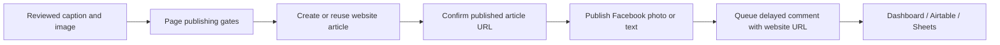

# NobleSeek website publishing

Requested destination: https://www.fabrything.com/nobleseek.

Status: integration planning. The public website responds, but its public HTML
does not establish the database provider, article schema or publication rules.
No website database writes or new Facebook publications have been made for this
integration. The connection fields below are a checklist, not an implemented
adapter.

## Information needed from the website owner

Provide these non-secret details in chat, or point to the website's local
repository and migration/schema files:

1. Backend and database provider, such as PostgreSQL/Supabase, MySQL, WordPress,
   or another CMS. Include whether the website already has an article API.
2. Article table name and schema: column names, types, required values/defaults,
   draft/published status values, author/category relationships, uniqueness rules
   and any row-level security policies that affect publishing.
3. One existing public article URL and the slug/route rule used to create it.
   Database IDs are not necessarily public article routes.
4. How images are stored: public URL fields, an uploads/media table or object
   storage. Include required caption, alt text, credit and cover-image fields.
5. Any cache invalidation, indexing, webhook or additional step needed after an
   insert for a newly published article to appear on the website.
6. Whether website articles should be created as drafts during generation, or
   only when a reviewed item is published immediately or its schedule becomes due.

A SQL `CREATE TABLE` definition or migration file is preferable to an export of
real article data. A sanitized sample row can clarify rich-text/JSON structures.
Never include passwords, tokens, private keys or a database connection string in
chat or a schema file committed to Git.

## Private connection setup

After the backend is identified, the connector will define the exact environment
variables it reads. Save credentials only in this local ignored file:

`C:\Users\bhnbi\Music\echolink\.env.local`

Use a dedicated account limited to the relevant article/media tables and required
operations. For an SQL connection, the necessary details are host, port, database,
username, password and SSL requirements, or the equivalent provider connection
URI. For an existing CMS API, the necessary details are the base URL, article
endpoint and a restricted server-side publishing credential. Provider-specific
credentials must stay on the local worker; they must not be sent to browser code.

EchoLink's existing `DATABASE_URL` belongs to its own state database. Do not
replace it with the website connection. The website may use a separate database,
even when both providers are PostgreSQL.

## Planned delivery sequence

The connector must map the real website schema, preserve original publisher
attribution and store the website record ID and public URL in EchoLink. It must
use an external ID or another verified unique mapping to avoid creating a second
website article when a job retries. Website publication and Facebook publication
are separate operations: if Facebook fails after website success, retry Facebook
against the saved article URL. An uncertain website write must be reconciled
before another insert.

The new URL belongs in the delayed comment for newly published Facebook posts.
The original publisher URL remains in the article's attribution and audit record.
Existing posted items and already queued comments must not be changed implicitly.
Website failure must hold Facebook delivery when website-first mode is enabled;
silently substituting the original publisher link would break the requested flow.

## Acceptance checks after setup

- Read-only connection and schema validation using the restricted credential.
- A draft article mapped to all required fields, including image and attribution.
- A reviewed publication visible at its canonical public website URL, including
  any required cache refresh or CMS indexing step.
- Retry after website success creates no duplicate article.
- Facebook photo/text delivery uses the reviewed content and existing gates.
- The delayed comment contains the saved public website URL and is confirmed
  remotely after its configured delay.
- Dashboard, Airtable and Google Sheets expose both delivery outcomes without
  credentials or private connection details.
